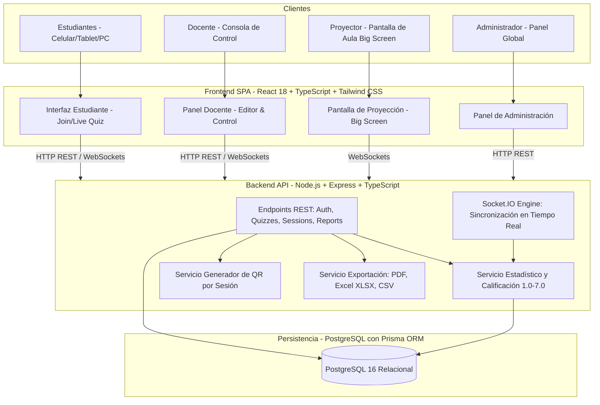
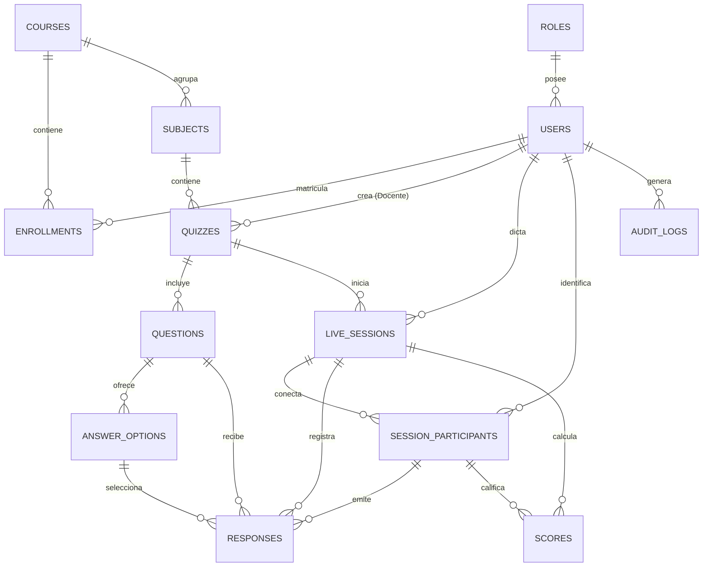

# AulaLive — Plataforma Interactiva de Preguntas y Estadísticas en Tiempo Real

> Sistema web de respuesta interactiva en aula similar a Kahoot, Mentimeter y Wooclap, diseñado para docentes y estudiantes de educación superior y técnica.

---

## 1. Arquitectura del Sistema



---

## 2. Modelo Relacional de Base de Datos (PostgreSQL)



---

## 3. Tipos de Preguntas Soportadas

1. **Selección única (`SINGLE_CHOICE`)**: Alternativas A, B, C, D con una sola respuesta correcta.
2. **Selección múltiple (`MULTIPLE_CHOICE`)**: Múltiples casillas de verificación.
3. **Verdadero o falso (`TRUE_FALSE`)**: Opciones booleanas de confirmación rápida.
4. **Respuesta corta (`SHORT_ANSWER`)**: Entrada de texto con normalización (trim, mayúsculas/minúsculas).
5. **Nube de palabras (`WORD_CLOUD`)**: Agregación de frecuencias semánticas en tiempo real.
6. **Escala Likert (`LIKERT`)**: Valoración perceptual del 1 al 5.
7. **Encuesta de opinión (`POLL`)**: Sondeo abierto sin respuesta correcta fija.
8. **Ordenamiento de elementos (`ORDERING`)**: Secuenciación interactiva de pasos o algoritmos.
9. **Preguntas con imágenes**: Recursos visuales adjuntos a enunciados y alternativas.
10. **Preguntas con temporizador**: Conteo regresivo (10 a 60 segundos) con bonificación de velocidad.

---

## 4. Credenciales de Demostración Iniciales

| Perfil | Correo Electrónico | Contraseña | Rol / Permisos |
| :--- | :--- | :--- | :--- |
| **Administrador** | `admin@aulalive.edu` | `Admin1234*` | Control total, usuarios, asignaturas, auditoría global |
| **Docente** | `docente@aulalive.edu` | `Docente1234*` | Crear cuestionarios, dictar sesiones, emitir reportes |
| **Estudiante** | `alumno@aulalive.edu` | `Alumno1234*` | Ingreso mediante PIN o QR sin contraseña |

---

## 5. Despliegue Rápido con Docker Compose

```bash
# 1. Clonar o ingresar al directorio
cd d:\unidad2\aulalive

# 2. Levantar la base de datos PostgreSQL, Backend y Frontend
docker-compose up --build -d

# 3. Verificar estado de contenedores
docker-compose ps
```

- **Frontend Docente y Estudiante:** `http://localhost:5173`
- **Backend API REST & Socket.IO:** `http://localhost:4000`
- **Healthcheck:** `http://localhost:4000/api/health`
- **Base de Datos PostgreSQL:** `localhost:5432` (usuario: `postgres`, base: `aulalive_db`)

---

## 6. Ejecución Local en Desarrollo (sin Docker)

### Requisitos previos:
- Node.js v18+ y npm
- Servidor PostgreSQL activo en el puerto 5432

### Paso 1: Configurar y levantar el Backend
```bash
cd d:\unidad2\aulalive\backend
npm install
npx prisma generate
npx prisma db push
npm run prisma:seed
npm run dev
```

### Paso 2: Levantar el Frontend
```bash
cd d:\unidad2\aulalive\frontend
npm install
npm run dev
```

---

## 7. Especificación de Eventos WebSocket (Socket.IO)

| Evento | Origen | Destino | Descripción |
| :--- | :--- | :--- | :--- |
| `session:join_room` | Cliente | Servidor | Une al usuario a la sala `session_{id}` |
| `session:participant_joined` | Servidor | Docente/Proyector | Notifica llegada de un nuevo alumno |
| `teacher:start_session` | Docente | Servidor | Inicia el cuestionario y publica la Pregunta 1 |
| `session:started` | Servidor | Todos | Arranca la actividad en todos los dispositivos |
| `student:submit_answer` | Estudiante | Servidor | Envía respuesta con tiempo de reacción |
| `session:stats_update` | Servidor | Docente/Proyector | Distribución de votos y porcentajes en vivo |
| `student:answer_confirmed` | Servidor | Estudiante | Confirmación de recepción y puntos |
| `teacher:toggle_results` | Docente | Todos | Muestra u oculta los gráficos dinámicos |
| `teacher:toggle_correct` | Docente | Todos | Revela la respuesta correcta oficial |
| `teacher:next_question` | Docente | Todos | Pasa a la siguiente pregunta y resetea temporizador |
| `teacher:finish_session` | Docente | Todos | Cierra la sesión y muestra el podio final |

---

## 8. Exportación y Reportes Oficiales

- **Planilla Excel (.xlsx):** Genera libro con hojas de *Resumen de Sesión*, *Calificaciones de Alumnos* (escala 1.0 a 7.0 al 60% de corte) y *Bitácora de Respuestas por Pregunta*.
- **Reporte CSV:** Archivo delimitado por punto y coma con codificación UTF-8 con BOM para apertura nativa en Microsoft Excel.
- **Documento PDF Oficial:** Acta formal de calificaciones con membrete, KPIs de aprobación y listado ordenado por ranking.

